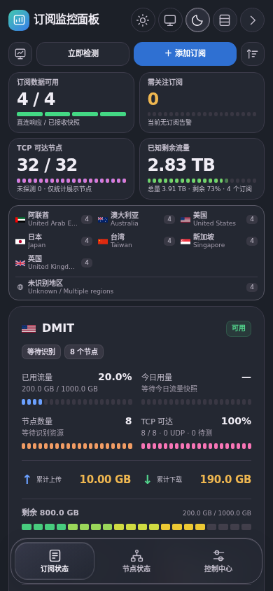
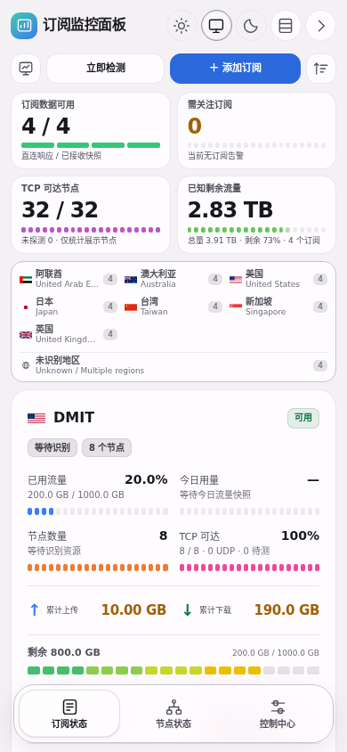

<div align="center">

# 订阅监控面板

**Subscription Monitor · 在一个面板里查看订阅额度、到期情况与节点 TCP 状态**

Cloudflare Workers + KV · 自托管 · 单文件部署 · 响应式界面

[](LICENSE)
[](https://developers.cloudflare.com/workers/)
[](CHANGELOG.md)

[快速部署](docs/deployment.md) · [使用说明](docs/user-guide.md) · [解析兼容性](docs/parsing.md) · [问题排查](docs/troubleshooting.md) · [English](README.en.md)

</div>


## 为什么做这个项目

订阅分散在不同客户端和服务商面板里，节点能够导入也不代表流量、到期和连通性都能被识别。本项目把这些信息汇总到一个自己控制的网页，既保留紧凑的手机排版，也让桌面端展示更多信息。

它适合个人集中查看多个订阅与节点端点。数据来自订阅响应或你上传、推送的内容；不会凭空补出服务商没有提供的剩余额度。

## 功能

| 模块 | 已实现内容 |
| --- | --- |
| 订阅概览 | 已用、剩余、总量、到期、订阅状态、节点数量、检测时间 |
| 今日用量 | 按 Asia/Shanghai 日界线，从额度快照计算差值；标记不完整统计 |
| 多种来源 | HTTPS 链接拉取、UTF-8 YAML / JSON / 文本文件导入、外部推送 |
| 多种格式 | 节点链接与 Base64、Clash YAML / JSON、sing-box JSON、部分文本配置 |
| 流量兼容 | 响应头、正文元数据、流量备注、QX info、Shadowrocket STATUS |
| 节点观察 | Cloudflare 到节点端点的 TCP 建连耗时、协议数量、名称推断地区 |
| 交互界面 | 详细 / 紧凑 / 磁贴 / 表格四种布局，白天 / 系统 / 黑夜主题 |
| 细节体验 | 液态按钮反馈、卡片拖动排序、同行折叠工具、底部导航、安全区适配 |
| 中控与排查 | 中控大屏、采集记录、异常摘要、JSON 状态快照、版本记录 |
| 自托管 | 单个 Worker + KV，Bearer 口令保护 API，可配置 Cron |

## 界面预览

所有截图使用本仓库生成的模拟数据，不包含实际订阅链接或账号数据。

| 黑夜模式 | 手机端 |
| --- | --- |
|  |  |

[查看四种布局](docs/screenshots.md)。首屏与卡片内容会根据屏幕宽度调整；手机端和桌面端不强行使用同一密度。

## 快速开始

### 在 Cloudflare 网页编辑器部署

1. 创建一个 **Workers 模块 Worker**，复制根目录 [worker.js](worker.js) 的完整源码到编辑器，保存部署。
2. 创建 Workers KV namespace，并绑定为 **`SUB_KV`**。
3. 添加 Secret **`ADMIN_TOKEN`**，使用自行生成的长随机口令，重新部署。
4. 打开 Worker 地址，用该口令进入面板，添加订阅或导入文件。
5. 如需页面关闭后继续刷新，在 Worker 中添加 Cron，例如 `*/30 * * * *`。

[worker.txt](worker.txt) 与 worker.js 内容完全一致，方便从 GitHub 文件视图复制。无需安装 Node.js 即可使用网页部署方式。

### 用 Wrangler 部署

本地需要 Node.js 22 或更新版本。以下配置 ID 必须替换为自己的值：

```bash
git clone https://github.com/chenran71ran-oss/subscription-monitor.git
cd subscription-monitor
npm ci
cp wrangler.example.toml wrangler.toml
npx wrangler login
npx wrangler kv namespace create SUB_KV
```

把返回的 namespace ID 填入 `wrangler.toml` 的 `[[kv_namespaces]]`，再执行：

```bash
npm run check
npx wrangler deploy
npx wrangler secret put ADMIN_TOKEN
```

在 PowerShell 中用 `Copy-Item wrangler.example.toml wrangler.toml` 替代 `cp`。[完整部署、升级和迁移说明](docs/deployment.md)。

## 使用前需要理解的边界

- **节点解析成功 ≠ 流量已获取。** 上游没有提供可识别的额度字段时，额度显示未知或保留带时间的旧快照。
- **一次性流量可以解析，但需要上游字段。** 无到期字段不会自动伪造“永久”；只剩余字段不会伪造总量。
- **TCP 延迟是 Cloudflare → 节点端点。** 它不是本地 → 节点延迟，也不验证代理认证、完整协议或网页出口。
- **这不是 QX / Clash / mihomo 内核。** 解析器提取监控所需字段，没有运行代理协议栈；UDP / QUIC 节点不使用 TCP 检测。
- **文件导入是静态快照。** 可解决一部分远程拉取受限的问题，不会自行刷新流量。
- **浏览器每 60 秒读取状态，不触发检查。** 自动刷新采集数据需要 Cron 或外部推送。
- **当前没有官网登录抓取、自动更新代码或自动回退模块。** 控制中心只保留版本记录。

详见 [能力边界](docs/limitations.md) 和 [安全说明](SECURITY.md)。

## 文档导航

| 文档 | 内容 |
| --- | --- |
| [部署与升级](docs/deployment.md) | 网页编辑器、Wrangler、KV、Secrets、Cron、旧版迁移 |
| [使用指南](docs/user-guide.md) | 三个视图、四种布局、主题、文件、手动校准 |
| [解析与流量](docs/parsing.md) | 输入格式、流量来源、优先级、未知值、样例 |
| [节点与延迟](docs/latency.md) | TCP 测量含义、结果分类、资源预算 |
| [API 参考](docs/api.md) | 鉴权、请求字段、状态字段、错误码 |
| [推送接入](docs/push.md) | 受信任的本地采集、现代与旧版接口 |
| [架构与数据](docs/architecture.md) | 构建链、请求链、KV 数据、并发边界 |
| [问题排查](docs/troubleshooting.md) | 403、无额度、文件失败、检测缺失、旧快照 |
| [开发指南](docs/development.md) | 源码目录、构建、离线测试、浏览器测试 |
| [设计决策](docs/design-decisions.md) | 整理本项目需求演进与保留 / 删除的设计 |
| [兼容迁移](docs/migration.md) | 从原单文件版升级，口令与 KV 保持一致 |
| [路线图](docs/roadmap.md) | 当前已完成与尚未实现的候选事项 |
| [开源基线](docs/open-source-baseline.md) | 参考项目、文档组织方法、发布检查 |
| [版本记录](CHANGELOG.md) | v01 首次开源与 Demo 开发历史 |

## 开发与贡献

```bash
npm ci
npm run build
npm run check
npx playwright install chromium
npm run test:ui
```

可维护源码在 `src/` 和 `web/`，根目录 Worker 由构建生成；不要只修改生成文件。构建为确定性拼接，不引入前端框架或线上 CDN。首次开源版为 v01（工具包版本 0.1.0），源自 Demo v18；调整版本文案，保留已确认的 UI 布局和核心行为。

欢迎提交最小可复现的解析样例、界面问题和文档修正。**请先脱敏，禁止上传真实订阅 token、节点凭证、口令或完整 KV 备份。** 详见 [CONTRIBUTING.md](CONTRIBUTING.md)。

## 致谢与许可

文档组织参考 [Uptime Kuma](https://github.com/louislam/uptime-kuma)、[Komari](https://github.com/komari-monitor/komari) 和 [Sub-Store](https://github.com/sub-store-org/Sub-Store)。流量兼容研究参考 [KOP-XIAO 的 Quantumult X 资源解析器](https://github.com/KOP-XIAO/QuantumultX)。本仓库没有打包或执行该远程脚本。

本项目代码采用 [MIT License](LICENSE)。第三方项目保留各自许可，商标和产品名称归各自权利人所有。[来源说明](NOTICE.md)。
