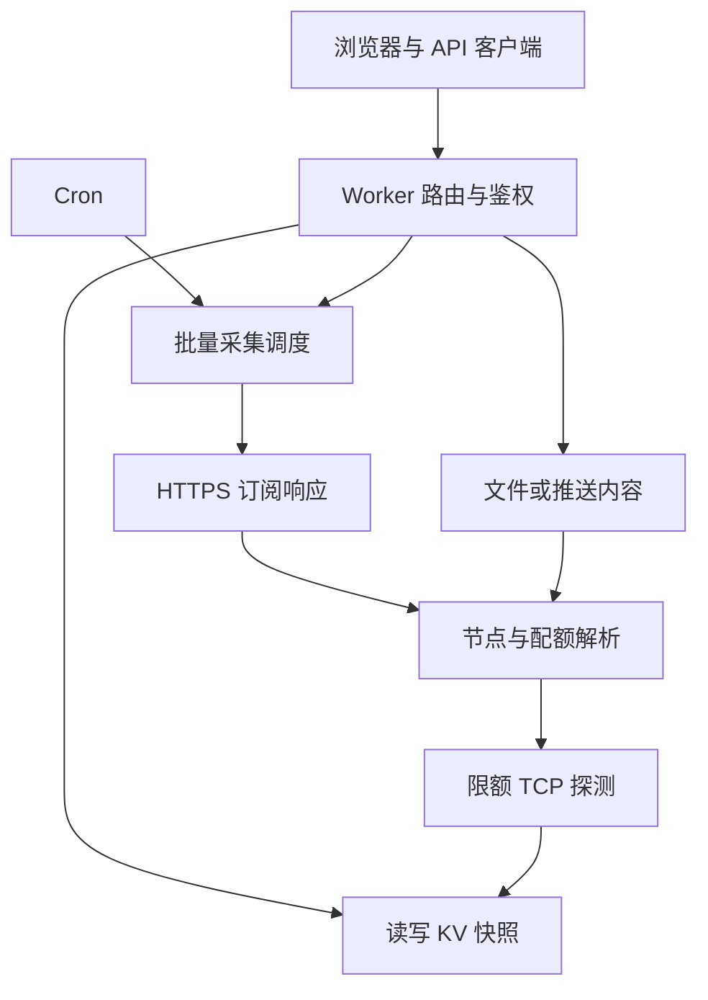

# 架构与数据模型

## 请求链

所有 UI 文件构建时内嵌在 Worker 中。同源请求，无运行期前端 CDN 或远程执行脚本。`/` 与 `/index.html` 提供页面，`/favicon.svg` 提供图标，`/robots.txt` 拒绝索引；这不是访问控制，API 仍需要口令。

## 代码目录

<table align="center">
<thead>
<tr><th align="center">路径</th><th align="center">职责</th></tr>
</thead>
<tbody>
<tr><td align="center">src/worker.js</td><td align="center">Worker 后端：路由、抓取、解析、KV、探测；保留嵌入标记</td></tr>
<tr><td align="center">web/index.html</td><td align="center">页面结构与两个资源嵌入标记</td></tr>
<tr><td align="center">web/styles.css</td><td align="center">主题、响应式布局与动效</td></tr>
<tr><td align="center">web/app.js</td><td align="center">界面渲染、交互、同源 API、客户端偏好</td></tr>
<tr><td align="center">scripts/build.mjs</td><td align="center">确定性嵌入资源，生成单文件 Worker</td></tr>
<tr><td align="center">worker.js / worker.txt</td><td align="center">部署成品，两份内容一致</td></tr>
<tr><td align="center">tests/</td><td align="center">离线配额 / API / 响应式交互验证</td></tr>
<tr><td align="center">examples/</td><td align="center">脱敏资源与推送示例</td></tr>
<tr><td align="center">docs/</td><td align="center">使用、技术、设计与社区文档</td></tr>
</tbody>
</table>

未引入前端构建框架。根目录成品是维护便利与网页编辑器便利之间的折中，CI 检查它们与可维护源码一致。

## KV

`list` 保存订阅定义；`data:<id>` 保存每条记录及历史快照。pull 定义含私密订阅链接；push 定义不保存原链接。后端解析节点中包含 host / port；公开 API 映射去掉这些字段。

历史为约八天内有效配额采样，用于日用量计算。没有长期统计数据库。记录 ID 为 UUID 截取的八位值，规模上限 30；不要把 ID 当秘密或靠难猜 ID 代替鉴权。

KV 最终一致；列表更新与单条记录写入没有跨键事务。多浏览器、Cron 与 push 同时修改可能出现短暂旧值或覆盖。当前没有 Durable Objects 锁、数据库迁移器或多用户隔离。

## 采集调度

批量按较旧检查时间优先。订阅拉取并发 2，先完成资源获取，再分配节点探测。整体网络预算 40；UA 尝试 / 重定向 / 配额补充 / 节点重试都消耗预算。

单订阅抓取整体 24 秒，单次 fetch 超时 10 秒，连续传输失败最多 2 次；重定向最多 3 次；429 / 503 终止当前尝试。配额补充最多一个有冷却请求。旧节点和配额保留时必须同时保留数据时间，不让历史值冒充新抓取成功。

## 安全边界

页面 CSP 只允许同源连接，禁用任意外部脚本 / 图片；内嵌脚本和样式需要 unsafe-inline。这不是完整 XSS 安全证明。管理口令保存到当前浏览器 localStorage；在自己的受信任设备使用。

URL 校验拒绝 HTTP、IP 字面量、用户名密码和部分本地域名；不解析并锁定 DNS，不能宣称完整 SSRF 防护。节点 host 来自资源内容，Worker 的出站限制仍是必要边界。详见 [SECURITY](../SECURITY.md)。
