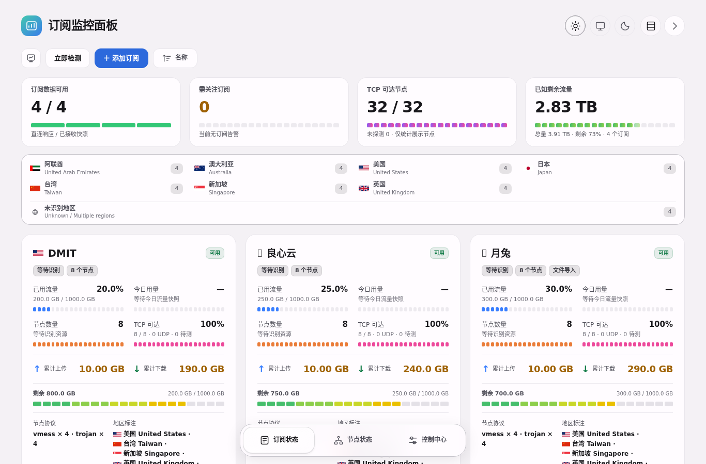
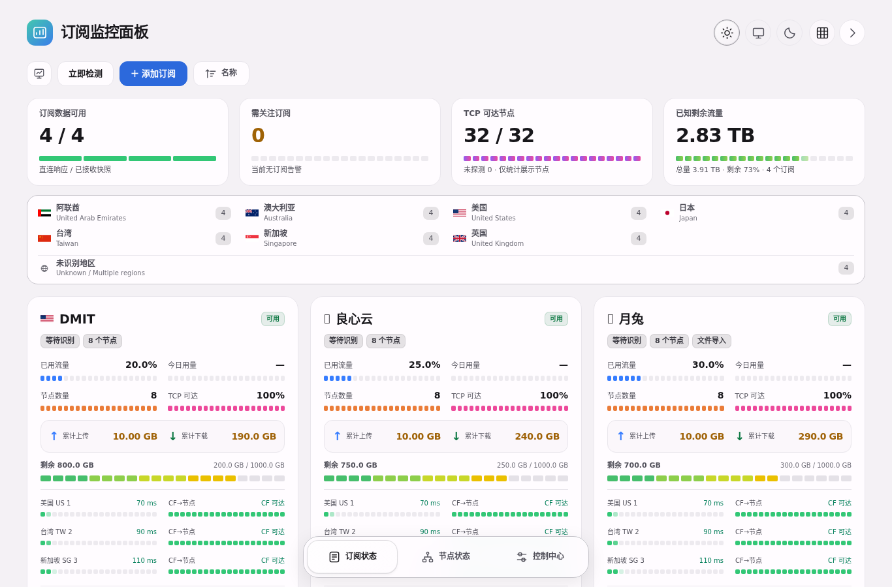
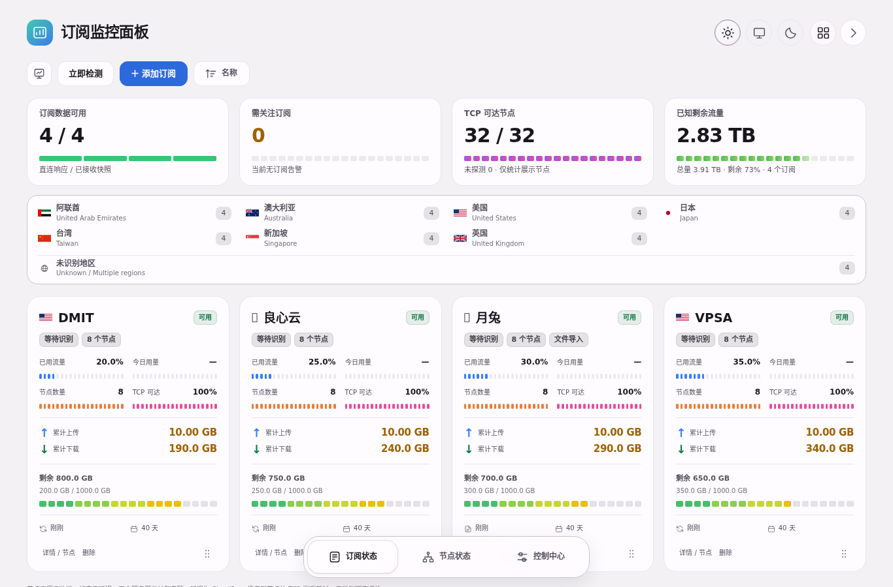
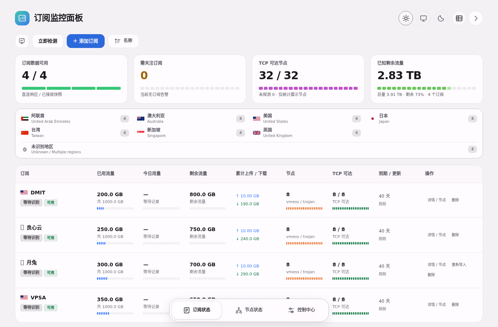

# 界面预览

以下来自开源前 Demo 界面的本地模拟数据；v01 保留同样的布局，版本记录文案已更新。不是生产可用率或真实额度证明。

## 桌面 / 手机

## 四种布局

<table align="center">
<thead>
<tr><th align="center">详细</th><th align="center">紧凑</th></tr>
</thead>
<tbody>
<tr><td align="center"></td><td align="center"></td></tr>
</tbody>
</table>

<table align="center">
<thead>
<tr><th align="center">磁贴</th><th align="center">表格</th></tr>
</thead>
<tbody>
<tr><td align="center"></td><td align="center"></td></tr>
</tbody>
</table>

布局切换只改变显示，不改变采集逻辑。截图可通过 `npm run test:ui` 重建到 `.artifacts/`，人工检查后再更新这里的发布图片。
